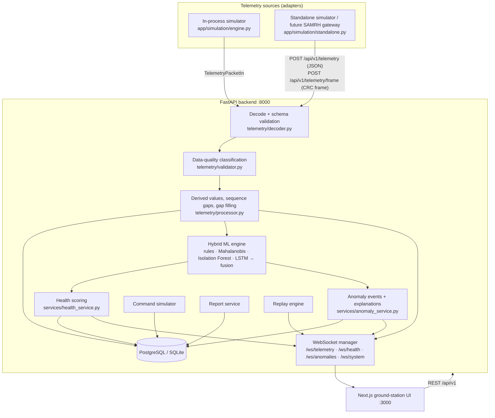
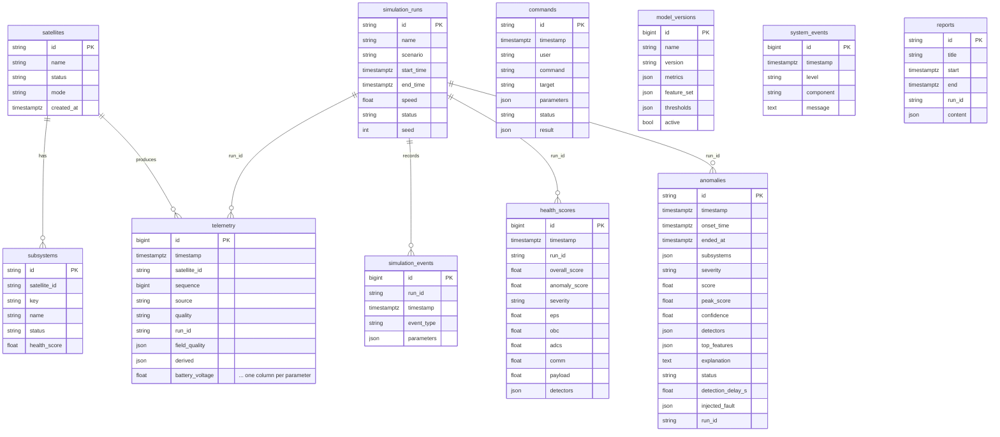
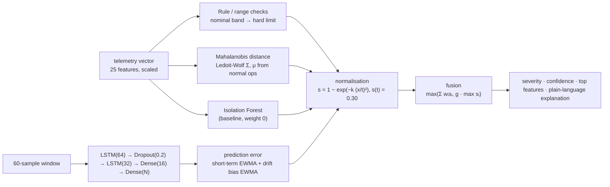

# System Architecture

Software-only / simulation-driven phase. The spacecraft is a software simulator; SAMRH/OBC hardware is
intentionally out of scope, but every interface is shaped so a hardware gateway can replace the simulator
without touching the dashboard, database or ML layers.

## 1. Component diagram



The orchestrator is `app/services/ground_station.py` (`GroundStation`). Every source enters through
`GroundStation.ingest()` / `ingest_frame()`; nothing downstream reads the packet `source` field except for
display, which is what makes the system source independent (spec §23).

### Per-packet pipeline

```
packet → decode/validate (422 + rejected_count on failure)
       → quality: VALID / SUSPECT / STALE / MISSING / OUT_OF_RANGE / CORRUPTED (worst field wins)
       → derived: power = V×I, temperature rates, sequence gap, packet-loss rate, freshness
       → persist telemetry row (one typed column per parameter)
       → ML inference (≈1–4 ms) → fused anomaly score, severity, confidence, top features
       → anomaly state machine (open after 3 samples ≥ 0.30, close after 15 normal samples)
       → health scores (overall + 5 subsystems) persisted to health_scores
       → WebSocket broadcast (telemetry, health, anomaly events)
```

A 2 s background loop publishes ground-station self-monitoring on `/ws/system` and logs a system event
when the telemetry stream goes stale, so satellite anomalies (anomalies table) are kept separate from
ground-station failures (system_events table).

## 2. Database ER diagram



Retention (spec §7.2): raw telemetry is kept for the demonstration dataset. Anomalies, simulation runs
(including their RNG seed and fault events) and model versions are never deleted, so any scenario can be
reproduced. With `TIMESCALE_ENABLED=true` and a TimescaleDB image, `telemetry` and `health_scores` become
hypertables; downsampling policies can then be added without touching anomaly records.

## 3. ML architecture



* **Features**: all numeric parameters except `obc_uptime`, plus `payload_active` (0/1). The order is
  persisted in `models/metadata.json`.
* **Scaler** is fit on the training split only (chronological 70/15/15).
* **Mahalanobis**: `D = sqrt((x−μ)ᵀ Σ⁻¹ (x−μ))`; per-feature attribution uses the additive decomposition
  `cᵢ = dᵢ(Σ⁻¹d)ᵢ`, weighted by each feature's own marginal deviation so a normal-valued but correlated
  variable is not blamed.
* **LSTM**: trained with Keras/TensorFlow, exported to `lstm_weights.npz` and run by an exact numpy
  re-implementation (`NumpyLSTMPredictor`, verified against Keras in the tests), so the API server does not
  load TensorFlow. Residuals are standardised by the validation residual σ; the score uses the max over
  features of an EWMA of r² (fast faults) and of an EWMA of r (slow sensor drift). Payload mode changes are
  commanded events the model can't foresee, so residuals are clipped for 5 samples after one
  (mode-transition masking). If TensorFlow is absent, a ridge autoregressive predictor over the same window
  is used and reported as the backend.
* **Thresholds** are the 99.9 % quantiles of each statistic on normal validation data. Normalisation maps
  the threshold to 0.30 (WARNING boundary), 2× to ≈0.76 (HIGH), 3× to ≈0.96 (CRITICAL).
* **Fusion** starts from the spec weights (rule 0.25, Mahalanobis 0.30, LSTM 0.45). A weighted mean
  dilutes a single confident detector (a pure link fault is seen only by the rule detector), so the fused
  score is floored at `g × max(detector)`. Weights and `g` are grid-searched on labelled validation fault
  runs to maximise event detection and point F1 under a 0.2 % normal-operation alarm budget; ties keep the
  spec weights.
* **Severity**: <0.30 NORMAL, 0.30 WARNING, 0.60 HIGH, 0.80 CRITICAL. Events need 3 consecutive samples.
* **Confidence**: detector agreement and margin, scaled down for degraded data quality.

## 4. Future SAMRH integration boundary

```
CURRENT:  Simulator ──► TelemetryPacketIn ──► GroundStation.ingest() ──► ML / DB / WS / UI
FUTURE:   SAMRH ─► Serial/CAN/RS-422/RF gateway ─► same packet (JSON or CRC frame) ─► POST /api/v1/telemetry[/frame]
```

* The schema (`app/telemetry/schemas.py`) is transport independent; a gateway only has to emit
  `{satellite_id, timestamp, sequence, source:"REAL", data:{...}}`. Missing parameters are allowed and are
  flagged MISSING (gap-filled for ML only).
* `app/telemetry/decoder.py` already implements the framed wire format (`SATF | len | JSON | CRC-16`) and
  counts bad frames as CORRUPTED. `app/simulation/standalone.py --framed` exercises exactly that path.
* Decoding is separate from ML inference, and the UI only consumes WebSocket messages, so adding a gateway
  means writing a new source adapter and changing no dashboard components. The top bar switches to
  `REAL` mode automatically when fresh `source:"REAL"` packets arrive.
* Commands use the same `{command, target, parameters}` schema with validation, confirmation and audit
  logging; a physical uplink would replace `command_service.execute()`.
